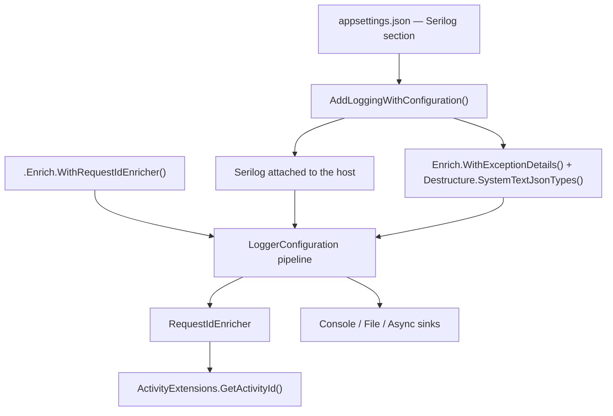

import DocCardList from '@theme/DocCardList';
import LogoSvg from '../../../../Assets/Images/logging.svg';

<p align="center">
<LogoSvg width={'15rem'} height={'15rem'} className="header_icon" />
</p>

# RA.Utilities.Logging.Core

[](https://www.nuget.org/packages/RA.Utilities.Logging.Core/)
[](https://www.nuget.org/packages/RA.Utilities.Logging.Core/)
[](https://codecov.io/github/RedonAlla/RA.Utilities)
[](https://github.com/RedonAlla/RA.Utilities/actions/runs/19519663272)
[](https://github.com/RedonAlla/RA.Utilities?tab=MIT-1-ov-file)

`RA.Utilities.Logging.Core` provides a **one-line, opinionated setup for production-ready structured logging with Serilog**. It ships the Serilog sinks and enrichers most APIs need and wires them from `appsettings.json`, keeping `Program.cs` free of logging boilerplate.

Use it when you want consistent, structured, configuration-driven logging without hand-assembling a Serilog pipeline in every service.

## 🎯 Purpose

Calling `builder.AddLoggingWithConfiguration()` in `Program.cs` hooks Serilog into the host and applies three opinionated defaults:

* **Configuration-driven** — reads the `Serilog` section of `appsettings.json` through `ReadFrom.Configuration`, so log levels, sinks, and enrichers are managed declaratively and per environment.
* **Exception details enrichment** — `Enrich.WithExceptionDetails()` (from `Serilog.Exceptions`) destructures exceptions with full type, message, and stack-trace detail.
* **System.Text.Json destructuring** — `Destructure.SystemTextJsonTypes()` (from `Destructurama.SystemTextJson`) renders `JsonElement` and related types as readable values instead of `ValueKind` enum names.

Request ID correlation is **opt-in**: call `.Enrich.WithRequestIdEnricher()` — or list `WithRequestIdEnricher` in the `Serilog` → `Enrich` array — to add the [`RequestIdEnricher`](./Enrichers/index.md), which contributes a `TraceId` property resolved from the `x-request-id` header, `HttpContext.TraceIdentifier`, or the current `Activity`.

### ✨ Key Features

- **One-call setup** — `AddLoggingWithConfiguration()` replaces the usual 20+ lines of manual Serilog wiring
- **No logging configuration in code** — sinks, levels, and enrichers are declared in `appsettings.json`
- **Async-friendly** — `Serilog.Sinks.Async` ships as a dependency, so I/O can be moved off the request thread with one config entry
- **Request correlation** — `RequestIdEnricher` carries a correlation id across HTTP requests, background work, and downstream calls
- **Structured JSON support** — `System.Text.Json` values destructure into readable structured properties
- **No hidden DI registrations** — the package registers nothing you did not ask for (`IHttpContextAccessor` included)

## 🛠️ Getting Started

### Prerequisites

- **.NET 10.0** or later
- An ASP.NET Core application — the entry-point extension targets `WebApplicationBuilder`

### Installation

**.NET CLI**

```bash
dotnet add package RA.Utilities.Logging.Core
```

**Package Manager Console**

```powershell
Install-Package RA.Utilities.Logging.Core
```

**PackageReference (csproj)**

```xml
<PackageReference Include="RA.Utilities.Logging.Core" Version="10.1.1" />
```

### Hello World

**1. Add a `Serilog` section to `appsettings.json`:**

```json showLineNumbers
{
  "Serilog": {
    "MinimumLevel": {
      "Default": "Information",
      "Override": {
        "Microsoft": "Warning",
        "System": "Warning"
      }
    },
    "WriteTo": [
      { "Name": "Console" }
    ]
  }
}
```

**2. Call the extension from `Program.cs` — as early as possible:**

```csharp showLineNumbers
using RA.Utilities.Logging.Core.Extensions;
using Serilog;

var builder = WebApplication.CreateBuilder(args);

// highlight-next-line
builder.AddLoggingWithConfiguration();

var app = builder.Build();

app.MapGet("/", () => "Hello World");

Log.Information("Application starting");
app.Run();
```

:::note
`AddLoggingWithConfiguration()` configures no sinks of its own — it delegates to your `Serilog` configuration. Without at least one `WriteTo` entry, log events have nowhere to go.
:::

## 🧠 Core Concepts

| Type | Role | Typical use |
|---|---|---|
| [`WebApplicationBuilderExtensions`](./Extensions/WebApplicationBuilderExtensions.md) | Host entry point | `builder.AddLoggingWithConfiguration()` |
| [`LoggerEnrichmentConfigurationExtensions`](./Extensions/LoggerEnrichmentConfigurationExtensions.md) | Fluent enricher registration | `.Enrich.WithRequestIdEnricher()` |
| [`ActivityExtensions`](./Extensions/ActivityExtensions.md) | Trace-id helper for `System.Diagnostics.Activity` | `Activity.Current?.GetActivityId()` |
| [`RequestIdEnricher`](./Enrichers/index.md) | Adds the `TraceId` correlation property to every event | activated from config or the fluent extension |

### How they work together



`AddLoggingWithConfiguration()` installs Serilog as the host logging provider and applies the two always-on enrichments. The `Serilog` configuration section then supplies levels, sinks, and any further enrichers — including `RequestIdEnricher`, which is activated either by name from configuration or through the fluent helper. At runtime the enricher resolves the current request id (the `x-request-id` header first, then `HttpContext.TraceIdentifier`) and falls back to `Activity.Current` through `GetActivityId()`, writing the result to the `TraceId` property before the event reaches the configured sinks.

### Terminology

- **Sink**: a Serilog output target, such as Console, File, or the Async wrapper.
- **Enricher**: a component that adds properties to a log event, for example `RequestIdEnricher` or `WithExceptionDetails`.
- **Destructuring**: serialising a complex object into structured properties with `{@Object}` instead of calling `ToString()`.
- **Log event property**: a named value attached to an event. This package contributes `TraceId`.
- **Enrichment**: the Serilog pipeline stage where enrichers add their properties. Order matters — later enrichers see the properties added by earlier ones.

## 📖 How-To Guides

### Configure production sinks (async file + console)

The package references `Serilog.Sinks.Console`, `Serilog.Sinks.File`, and `Serilog.Sinks.Async`, so they can be declared with no extra NuGet installs:

```json showLineNumbers
{
  "Serilog": {
    "MinimumLevel": {
      "Default": "Information",
      "Override": { "Microsoft": "Warning", "System": "Warning" }
    },
    "Using": [
      "Serilog.Sinks.Console",
      "Serilog.Sinks.File",
      "Serilog.Sinks.Async"
    ],
    "WriteTo:Async": {
      "Name": "Async",
      "Args": {
        "configure": [
          {
            "Name": "File",
            "Args": {
              "path": "Logs/app-.log",
              "rollingInterval": "Day",
              "rollOnFileSizeLimit": true,
              "outputTemplate": "{Timestamp:G} [{Level}] ({TraceId}) {Message:lj} ({SourceContext}){NewLine}{Exception}"
            }
          },
          {
            "Name": "Console",
            "Args": {
              "outputTemplate": "{Timestamp:G} [{Level}] ({TraceId}) {Message:lj} ({SourceContext}){NewLine}{Exception}"
            }
          }
        ]
      }
    }
  }
}
```

:::tip
`{TraceId}` renders in output templates. The enricher fills it from the `x-request-id` header when the client or a proxy sends one, so keeping that header intact across services gives you stable end-to-end correlation.
:::

### Turn on request ID enrichment

Request ID enrichment is opt-in and needs an `IHttpContextAccessor` registration so the enricher can read the current request:

```csharp showLineNumbers
using RA.Utilities.Logging.Core.Extensions;

var builder = WebApplication.CreateBuilder(args);

// highlight-next-line
builder.Services.AddHttpContextAccessor(); // required for WithRequestIdEnricher
builder.AddLoggingWithConfiguration();
```

Activate the enricher by name from configuration:

```json showLineNumbers
{
  "Serilog": {
    "Enrich": [
      { "Name": "WithExceptionDetails" },
      { "Name": "WithRequestIdEnricher" }
    ]
  }
}
```

Every log event written inside a request then carries a `TraceId`: the value of the `x-request-id` header when the client or an upstream proxy sends it, and otherwise `HttpContext.TraceIdentifier`.

### Configure Serilog manually and reuse the enricher

You are not tied to `AddLoggingWithConfiguration()`. The fluent helper works with any `LoggerConfiguration`:

```csharp showLineNumbers
using RA.Utilities.Logging.Core.Extensions;
using Serilog;

var builder = WebApplication.CreateBuilder(args);
builder.Services.AddHttpContextAccessor();

Log.Logger = new LoggerConfiguration()
    .Enrich.FromLogContext()
    // highlight-next-line
    .Enrich.WithRequestIdEnricher()
    .WriteTo.Console()
    .CreateLogger();
```

`WithRequestIdEnricher()` throws `ArgumentNullException` when the enrichment configuration is `null`, so it is safe to chain without guards.

### Correlate background jobs with `Activity` {#correlate-background-jobs-with-activity}

Outside an HTTP request there is no `x-request-id` and no `TraceIdentifier`, so the enricher falls back to the ambient activity. Start one to give a job a meaningful `TraceId`:

```csharp showLineNumbers
using System.Diagnostics;
using Serilog;

using var activity = new Activity("nightly-cleanup").Start();

// Every event in this scope now has a TraceId
Log.Information("Cleanup started");
```

Without an `HttpContext` **and** without an `Activity`, `TraceId` is still added but carries `null` — the package deliberately avoids inventing a random GUID per event.

### Mask sensitive data in logs

`Serilog.Enrichers.Sensitive` is included as a dependency; enable it declaratively:

```json showLineNumbers
{
  "Serilog": {
    "Using": [ "Serilog.Enrichers.Sensitive" ],
    "Enrich": [
      {
        "Name": "WithSensitiveDataMasking",
        "Args": {
          "options": {
            "MaskValue": "***SECRET***",
            "Mode": "Globally"
          }
        }
      }
    ]
  }
}
```

## ⚙️ Configuration

`RA.Utilities.Logging.Core` exposes **no options class and no code-level configuration of its own**. Everything is driven by the standard `Serilog` section of `appsettings.json`, which `AddLoggingWithConfiguration()` reads through `Serilog.Settings.Configuration`.

| Key | Type | Default | Description |
|---|---|---|---|
| `Serilog:MinimumLevel:Default` | string | `Information` | Global minimum log level. |
| `Serilog:MinimumLevel:Override` | object | — | Per-namespace minimum levels, e.g. `{ "Microsoft": "Warning" }`. |
| `Serilog:Using` | string[] | — | Assemblies scanned for sink and enricher types. |
| `Serilog:Enrich` | object[] | — | Enrichers to activate, e.g. `WithExceptionDetails`, `WithRequestIdEnricher`, `WithSensitiveDataMasking`. |
| `Serilog:WriteTo` | object[] | — | Sink definitions. Required — the package installs none. |
| `Serilog:Properties` | object | — | Static properties added to every event, e.g. `ApplicationName`. |

Two enrichers are applied in code regardless of this section: `Enrich.WithExceptionDetails()` and `Destructure.SystemTextJsonTypes()`. Declare them again in `Serilog:Enrich` only when you configure Serilog yourself instead of calling `AddLoggingWithConfiguration()`.

## 📦 Included Dependencies

These Serilog packages ship with `RA.Utilities.Logging.Core` and are available for declarative configuration — no additional NuGet installs required:

* **`Serilog.Sinks.Console`** — for easy viewing during development.
* **`Serilog.Sinks.File`** — persistent log storage with rolling and size limits.
* **`Serilog.Sinks.Async`** — wraps sinks to minimise the logging impact on request threads.
* **`Serilog.Enrichers.Sensitive`** — masks sensitive data (passwords, tokens, card numbers) in log output.
* **`Serilog.Exceptions`** — detailed exception destructuring, applied automatically.
* **`Destructurama.SystemTextJson`** — `System.Text.Json` destructuring, applied automatically.

## ✨ Available Components

### Extension Methods

| Method | Declared in | Extends | Purpose |
|---|---|---|---|
| [`AddLoggingWithConfiguration()`](./Extensions/WebApplicationBuilderExtensions.md) | `WebApplicationBuilderExtensions` | `WebApplicationBuilder` | Attaches Serilog to the host and applies the opinionated defaults |
| [`WithRequestIdEnricher()`](./Extensions/LoggerEnrichmentConfigurationExtensions.md) | `LoggerEnrichmentConfigurationExtensions` | `LoggerEnrichmentConfiguration` | Adds `RequestIdEnricher` to the pipeline |
| [`GetActivityId()`](./Extensions/ActivityExtensions.md) | `ActivityExtensions` | `Activity` | Returns the activity id as a `string?`, or `null` when no trace context exists |

:::info v10.1.1
`AddLoggingWithConfiguration()` and `WithRequestIdEnricher()` were previously declared together in a single `LoggingExtensions` class. Since v10.1.1 the methods live in one class per extended type, and all three classes are written as C# 14 extension members. Method names, signatures, and the `RA.Utilities.Logging.Core.Extensions` namespace are unchanged — see the [migration guide](./migration-guides) for details.
:::

### Other Types

| Type | Namespace | Purpose |
|---|---|---|
| [`RequestIdEnricher`](./Enrichers/index.md) | `RA.Utilities.Logging.Core.Enrichers` | Serilog `ILogEventEnricher` that contributes the `TraceId` correlation property |

## 🙌 Contributing & Support

### Found a bug or have a suggestion?

- **GitHub Issues**: [Report a bug or request a feature](https://github.com/RedonAlla/RA.Utilities/issues)
- **Discussions**: [Ask questions or start a discussion](https://github.com/RedonAlla/RA.Utilities/discussions)

### Contributing

Contributions are welcome! Please follow the standard workflow:

1. **Fork** the [RA.Utilities repository](https://github.com/RedonAlla/RA.Utilities)
2. **Create a branch** from `main` with a descriptive name (e.g. `feature/logging-scope-enricher`)
3. **Make your changes** — follow the existing coding style and add XML documentation for new public APIs
4. **Submit a pull request** to the `main` branch with a clear description

### Links

| Resource | URL |
|---|---|
| **NuGet** | [RA.Utilities.Logging.Core](https://www.nuget.org/packages/RA.Utilities.Logging.Core/) |
| **Source** | [GitHub — RedonAlla/RA.Utilities](https://github.com/RedonAlla/RA.Utilities) |
| **License** | [MIT](https://github.com/RedonAlla/RA.Utilities?tab=MIT-1-ov-file) |
| **Build Status** | [GitHub Actions](https://github.com/RedonAlla/RA.Utilities/actions/workflows/publish-nuget.yml) |

<br />
<br />

<DocCardList />
